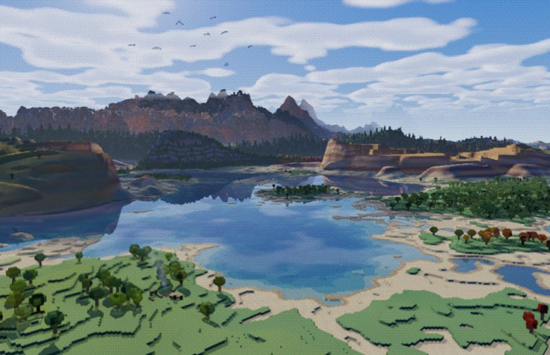
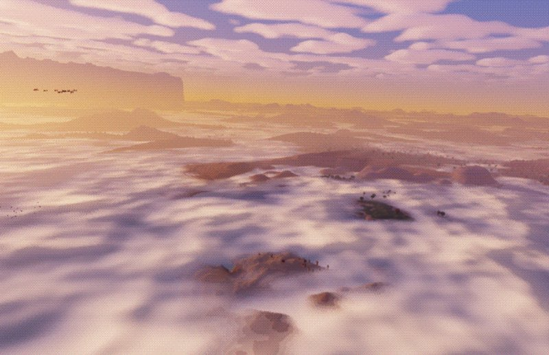
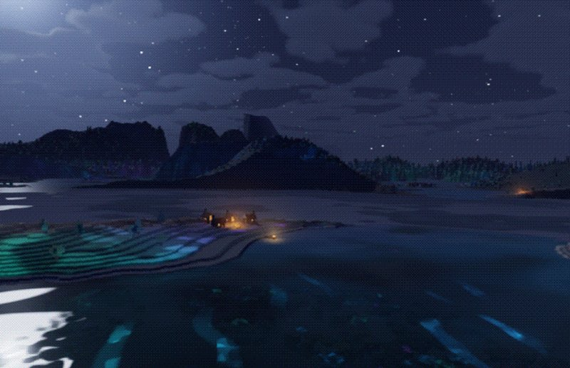

# Jack Lusher

I'm entirely self-taught; I started as a young teen with a stack of Java books as thick as my bookcase is wide. I've
always had a curiosity about how things work - especially videogames. When I learned Minecraft was written in the
language I already knew, I set to work recreating its engine and world-generation from scratch:
[Minedaft](https://github.com/Screendead/Minedaft). It's where I first cut my teeth on genuine software engineering,
and I had so much fun doing so.

## How I work

I operate like an executive leading a team of very smart and passionate engineers. It's not practicable to review
every line, so I have strict processes around which things need my attention and which don't - and taste, judgement,
and discernment are always my remit. If it can't be measured or proven, it's a judgement call that I need to make.
That keeps Claude honest, stops my projects from getting away from me, and keeps my hobby fun.

"Programming" takes up very little of my time nowadays. I'm not defensive about it. I do miss the late-night
debugging sessions, because I genuinely enjoyed them, but the "programming" was once the point for me; now I view it
as purely instrumental to the goal of producing things I love.

## On software

People who write software as a job rarely write great software. Not because they're dumb or they don't care; because
the incentives reward "good enough for now" and punish forward-thinking. In the age of AI, I think this is misguided.
You should be unreasonable in your expectations of agents. They don't sleep, they don't get tired, they don't want a
raise, and they never get bored. Make them do the drudgery, then make them do it again.

## COMTRAN

Nobody had written a [COMTRAN](https://github.com/Screendead/comtran-compiler) programme for more than twice as long
as I had been alive, and what's more, nobody even could. No compiler survives, and there's no tooling of any kind. I
wanted to be able to write code in a language nobody knows, to revive it for future historians and curious kids like
I used to be, and to do justice to the work Bob Bemer and others at IBM put into it. Then I found the manuals, and the
path forward was immediately clear.

You can write and run COMTRAN in your browser at [comtran.screendead.com](https://comtran.screendead.com).

## Also building

**[claudestone](https://github.com/Screendead/claudestone)** - Claude agents building Minecraft redstone: a 4-bit CPU,
a 16x16 piston door, and a two-digit adder from one sentence.

**[unstir](https://github.com/Screendead/unstir)** - an iPhone puzzle game. Rods stir a picture; you unwind it.

**[screensaver](https://github.com/Screendead/screensaver)** - STRATA, a generative voxel screensaver for macOS, in
Metal. An endless flight over procedural terrain, through a full day and night.

   

**[penchant](https://github.com/Screendead/penchant)** - a habit journal for iOS and macOS.

By day I build enterprise software at Certinia. Self-employed games development was always my dream career, though.
